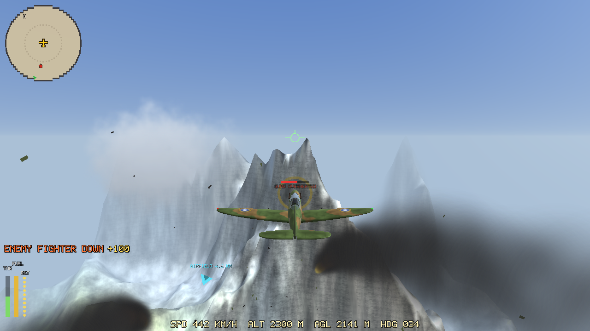

# Free Hunt 1943 (beta)

A free arcade WW2 air combat game for the **R36S** (PortMaster) and **Android**.

Climb into a Spitfire and fly as long as you like over an endless world that is new every
time: green highlands, desert canyons, snowy peaks and open sea, through changing weather
from dawn to starry night. Hunt whatever you find down there and up there. There is no game
over and nobody tells you what to do: it is a sandbox, and we will let you discover the rest
for yourself.

| | |
|---|---|
|  |  |
|  |  |

> This repository is for players: downloads (on the Releases page) and the place to report
> bugs and share ideas. The game is in beta, so expect rough edges and please tell us about them.

## Download

Get the latest build from the **[Releases](../../releases)** page:

- `freehunt1943.zip` for the R36S and other PortMaster handhelds (aarch64)
- `free-hunt-1943.apk` for Android phones

The newest build is always at these fixed links:

- https://github.com/hyankov/free-hunt-1943/releases/latest/download/freehunt1943.zip
- https://github.com/hyankov/free-hunt-1943/releases/latest/download/free-hunt-1943.apk

## Install

### R36S and other PortMaster handhelds (autoinstall)

1. Copy `freehunt1943.zip` **as it is, without unzipping it** to
   `ports/PortMaster/autoinstall/` on the SD card (on ArkOS the card with the
   `roms` folder, so `roms/ports/PortMaster/autoinstall/`).
2. Put the card back, open **PortMaster** from the Ports menu once. It installs the
   game and removes the zip.
3. Restart EmulationStation (or the console). **Free Hunt 1943** shows up under Ports.

**Over Wi-Fi instead of taking the card out** (ArkOS and similar, needs Wi-Fi on the device):

1. On the handheld, open **Options > Enable Remote Services** and note the IP address it shows.
2. On a computer on the same network, open the device's file share (Windows: `\\<IP>` in
   File Explorer; macOS: Finder > Go > Connect to Server > `smb://<IP>`), or its web file
   browser at `http://<IP>` if your firmware has one.
3. Copy `freehunt1943.zip` (still zipped) into `ports/PortMaster/autoinstall/` (inside the
   `roms` share on ArkOS), then open PortMaster once and restart, as above. Turn Remote
   Services off again afterwards.

To update, do the same with the new zip. Your settings and logbook are kept.

**One-button updates (Wi-Fi):** copy
[`Update Free Hunt 1943.sh`](tools/Update%20Free%20Hunt%201943.sh) into your `ports` folder
(next to `FreeHunt1943.sh`) and restart once. From then on, run **Update Free Hunt 1943** from
the Ports menu: it downloads the newest release and installs it, keeping your settings and logbook.

### Android

Download the APK on the phone, open it and allow installs from that source when asked.
To update, install the new APK over the old one.

## Controls

### R36S / gamepad

| Button | Action |
|---|---|
| Left stick | Fly: pitch and turn (the plane banks for you) |
| Right stick | Look around (springs back when you let go) |
| D-pad up / down | Throttle up / down (hold) |
| D-pad left / right | Air brake (hold) |
| R1 (hold) | Cannons (they overheat) |
| L1 | Rocket |
| L2 / R2 | Rudder left / right |
| A (hold) | Big map |
| B (hold) | Zoom on the instrument panel |
| X (hold) | Padlock: keep the view on the nearest enemy |
| Y | Change camera: cockpit, clear view, chase |
| R3 (hold 1 s) | Bail out |
| Start | Menu / pause |
| Select + Start | Quit |

All buttons can be remapped in **OPTIONS > CONTROLS > BUTTONS**.

### Android

On-screen stick bottom left, throttle lever bottom right with BRAKE, VIEW, CENTER and
LOCK beside it, FIRE and ROCKET next to those, pause top right. Turn the phone to look
around (gyro); CENTER sets "straight ahead". With **SWAP STICKS** the gyro flies the
plane instead. A connected gamepad works too and hides the touch controls.

## Report a bug or share an idea

- **Bugs:** open an [issue](../../issues/new/choose) with the *Bug report* form. The device,
  firmware and game version help a lot, and a photo or screenshot even more.
- **Slow game?** Use the *Performance* form and turn on **OPTIONS > VIDEO > FPS COUNTER**
  to tell us the number you see.
- **Ideas and questions:** use [Discussions](../../discussions) or the *Idea* form.

Please search the open issues first; a thumbs-up on an existing one counts too.

## Credits

Made by hyankov. All graphics and sounds are generated by the game itself.
Uses [SDL2](https://libsdl.org) (zlib license) and
[stb_image](https://github.com/nothings/stb) (public domain / MIT).

Free Hunt 1943 is free to download and play, and you may share the official release files
unchanged and for free. Selling it, bundling it on devices that are sold, or modifying it is
not allowed. See [LICENSE](LICENSE). The source code is not public.
